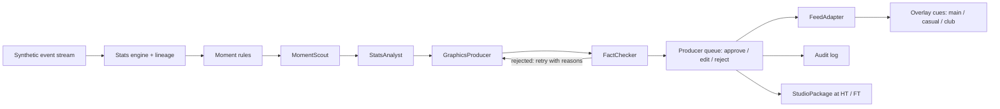

# Producer Co-pilot

An agent-assisted live graphics desk for football broadcasts. A team of AI agents watches a live (synthetic) match feed, proposes the right on-screen graphic at the right moment, explains why it matters now, and fact-checks every number before a human producer sees it. One approval puts the graphic on air at once in three feeds (TV, fan app, club channel) as timed, machine-readable overlay cues, while a neural-voice commentator calls the match from the same verified data.

Built for the Microsoft x Premier League **Inside the Game** developer hackathon. Category: **Best Multi-Agent System**.

**Live demo (Azure Container Apps):** https://producer-copilot.politefield-ec1b9bf6.southeastasia.azurecontainerapps.io — no login or install needed. Press **Start match**.

**Demo video (1:45):** https://youtu.be/uln4tPr0E_E (also in the repo at [`docs/producer-copilot-demo.mp4`](docs/producer-copilot-demo.mp4))


## The problem

A live graphics producer has a few seconds to decide what goes on screen. Under that pressure, broadcasts fall back on generic numbers ("possession 58%") that tell viewers nothing new. The insight that explains a moment, such as "their press has won the ball high 4 times in 6 minutes", arrives too late or never. AI could help, but a hallucinated number on live TV is a serious problem, so AI output cannot go on air unchecked.

## What it does

| Stage | How |
| --- | --- |
| **Ingest** | A seeded synthetic match (passes, carries, shots, tackles, pressure, possession changes, fouls, metadata) is replayed as a live event stream at an adjustable speed. |
| **Interpret** | A deterministic stats engine computes possession, pass length, accuracy and a 0-100 difficulty rating, shot speed and xG, sprint speed, a rolling momentum index, and a control-vs-chaos index. Every value keeps the IDs of the events it came from. |
| **Explain** | The `StatsAnalyst` agent writes the "why now" for each moment: pressing, rhythm, game state, control vs chaos. |
| **Render** | The `GraphicsProducer` agent fills one of five broadcast templates within strict character limits. Approved graphics appear in the on-air preview and on `GET /api/overlays` as timed cues (`t_in`, `t_out`, template, slots, source events). |
| **Personalize** | The `FeedAdapter` agent rewrites each approved graphic for TV, a fan app for newcomers (plain words, no jargon) and a chosen club's own channel (first-person, partisan). Each version is fact-checked line by line and gets its own on-screen look. |
| **Ask the Match** | A fan-app agent answers fans' questions ("what happened at minute 30?", "who is making the best decisions?") in their own language by calling tools over the live match, so it knows nothing beyond the current minute. Every number is fact-checked. A verified answer can be sent to the producer as an on-screen **fan request**. |
| **Decision Lens** | Every pass is rated against the passer's other options with a simplified expected-threat model: missed forward options during attacking moments, brave forward passes, and a vision score per player. Teammate positions are estimated from the formation (event data has no off-ball tracking), and the UI says so. |
| **Substitutions & ratings** | Each team makes three second-half substitutions (the player coming on really plays: passes, shots and Decision Lens ratings). Every player gets a match rating from goals, chance quality, shots on target, defending, passing and the Decision Lens score; the Man of the Match is the top rating, explained component by component, and becomes a full-time graphic. |
| **Commentate** | Play-by-play and colour commentary built from the live events and computed stats, spoken by an Azure AI Speech neural voice whose style follows the moment: chat, excited, shouting for goals. |

## The agent team



The pipeline is a [Microsoft Agent Framework](https://github.com/microsoft/agent-framework) workflow (`WorkflowBuilder`) with a cycle between the `GraphicsProducer` and the `FactChecker`.

- **MomentScout** (rules-based executor) drops stale moments and repeats of graphics already proposed.
- **StatsAnalyst** (LLM agent) explains why the moment matters, using only the verified facts.
- **GraphicsProducer** (LLM agent) picks a template and writes the slots.
- **FactChecker** (deterministic executor) rejects any number that isn't in the facts and any slot over its character limit, then sends its reasons back to the `GraphicsProducer`. After 3 rejected drafts it substitutes a verified template, so the queue never stalls.
- **FeedAdapter** (LLM agent) creates the fan-app and club versions after approval, while the approved TV version is already on air. Each line is fact-checked; rejected lines go back to the agent once with the checker's reasons, and any line that still fails keeps the approved wording.
- **AskTheMatch** (LLM agent with five function tools: match overview, events by minute, player, team, Decision Lens) answers fans. Numbers in its answers must come from tool results; a failed answer gets one repair round, then a deterministic answer. Numbers a fan types can never reach a graphic.
- **StudioPackage** (LLM agent) builds a ranked half-time and full-time rundown plus a presenter script. The script's numbers are checked as well.

The human producer stays in control. Edits made by hand are fact-checked too, and every proposal, edit, approval and rejection is written to the audit log.

**Keeping pace with a live match:** approval airs the graphic immediately; three workers draft moments in parallel; moments that go stale before drafting, or wait too long for a decision, expire instead of reaching the producer late.

**Failure handling:** model errors, rate limits and unparseable replies all fall back to deterministic, verified templates, and the console keeps running. **Fault injection** (a toggle in the header) deliberately corrupts one number in each first draft, so you can watch the `FactChecker` catch it and the `GraphicsProducer` repair it.

## Microsoft technology

- **Microsoft Agent Framework (Python):** the agents, the workflow graph with its retry cycle, and the executors.
- **Microsoft Foundry:** the live demo's agents run on a `gpt-5-mini` deployment (Global Standard) through Agent Framework's OpenAI-compatible chat client, with `reasoning_effort=low` for live-desk latency. Switching providers only means changing `LLM_BASE_URL`, `LLM_API_KEY` and `LLM_MODEL`.
- **Azure AI Speech:** the commentator's neural voice (`en-US-DavisNeural`) with SSML speaking styles; usage is capped per minute and per day (`app/tts.py`).
- **Azure Container Apps:** hosts the public demo (`infra/deploy-azure.sh`); model and speech keys are Container Apps secrets.
- **GitHub Codespaces:** a one-click environment for judges (`.devcontainer/`).
- **GitHub Copilot:** used while building the project.

## Using the console

1. Press **Start match**. The synthetic game replays at 15× (5× feels closest to live and suits the commentator; 30× and 60× are for skimming). Stadium sound and the commentator start with the match; the speaker button mutes them.
2. The **Program** monitor shows the pitch from a broadcast camera angle with shirt numbers and who has the ball (**Top view** switches to a tactical view). Lineups are under **Match stats**.
3. The **Agent team** strip shows which agent is working and whether the Fact Checker passed or rejected a draft.
4. **Your decisions** lists graphics waiting for you, highest priority first. Read *Why now*, check the verification line, then **✓ Approve** (`A`), **Edit**, or **Reject** (`R`). Cards never move while your pointer is over the list.
5. Approved graphics air at once in the strip under the pitch, so the pitch stays clear. Switch **TV / Fan app / Club channel** to see each feed's look, and read all three texts side by side under **Feed versions**.
6. After every goal the replay pauses for a few seconds: the clock stops, the ball and players freeze, and a GOAL! card shows the scorer, minute and new score before play restarts. At half-time the replay rests briefly behind a studio card with the first-half numbers; the half-time and full-time rundowns appear under **Studio package** (**Build rundown now** makes one at any moment).
7. In **Fan app · Ask the Match**, ask anything about the match (any language) or tap a suggestion. Press **📺 Request this on screen** on a verified answer: a 📣 fan request appears in your decision queue.
8. Open **Decision Lens** to see missed options and brave passes, and the vision score per player; a missed option also shows on the pitch as an amber "open?" marker.
9. Open the settings (gear icon) to turn on **Fault test**, choose the club for the club channel, or switch the commentator voice off.

Every visitor gets their own console (match, queue and audit log), so several judges can test the public demo at the same time without affecting each other.

**Guided tour:** open the demo with `?demo=1` and press **Play without recording** for a two-minute narrated walkthrough of the live app (Azure AI Speech narrator, chapter titles, a highlight box on each feature). **Record demo** records the same tour from the tab; the demo video was made this way, with real agents and real voices, not edited footage.

## Run it

Requires Python 3.12 and [uv](https://docs.astral.sh/uv/).

```bash
uv sync
cp .env.example .env          # optional: set LLM_BASE_URL / LLM_API_KEY / LLM_MODEL for live models
uv run uvicorn app.main:app --port 8000
```

Then open http://localhost:8000 and press **Start**.

- **With a model configured:** set `LLM_BASE_URL`, `LLM_API_KEY` and `LLM_MODEL` for any OpenAI-compatible API. `.env.example` has examples for OpenAI, Groq, Ollama and Microsoft Foundry. The agents call that model, and every reply is cached in `data/llm_cache.json`.
- **Without a token:** the app replays cached replies first, then uses verified template fallbacks, so the full workflow still runs.
- **Codespaces:** open the repo in a Codespace. Dependencies install automatically and port 8000 opens in the browser. Run the `uvicorn` command above.

Keyboard shortcuts: `a` approves and `r` rejects the highest-priority pending suggestion.

### Test instructions for judges

1. Open the live demo (or start the server as shown above) and press **Start match**. 15× plays a full match in about 6 minutes.
2. Turn on **Fault test** in settings, then open a card's **How the agents got here** to see a draft rejected and repaired.
3. Press **✓ Approve** on a card, then compare **TV**, **Fan app** and **Club channel** under **Feed versions**.
4. Press **Edit** on a card and type a number that isn't in the facts. The Fact Checker blocks the edit.
5. Open http://localhost:8000/api/overlays to see the machine-readable cue sheet, or `/api/audit` for the audit log.

## Deploy to Azure Container Apps

From Azure Cloud Shell (no local Docker needed):

```bash
git clone https://github.com/Albategnius/producer-copilot && cd producer-copilot
bash infra/deploy-azure.sh                       # deterministic templates only
LLM_BASE_URL=https://<resource>.openai.azure.com/openai/v1/ LLM_API_KEY=<key> LLM_MODEL=<deployment> \
  bash infra/deploy-azure.sh                     # with a Microsoft Foundry model
```

For the neural commentator, add the Azure AI Speech (or Foundry AIServices) key as a secret and set `SPEECH_KEY=secretref:<secret>` and `SPEECH_REGION=<region>` on the container app. Keys are stored as Container Apps secrets, never in the image or the repository. The app runs on one replica because each visitor's console is kept in memory.

## Synthetic data

`app/generator.py` is a seeded possession state machine with benches and three second-half substitutions per team (drawn from a separate random stream, so the match itself is unchanged by them): zone-dependent pass, carry and shot probabilities, team pressing spells, and player passing, finishing and pace ratings. Its output is tuned so each match lands near typical top-flight averages: about 400-500 passes per team at about 80% accuracy, 9-16 shots per team, and realistic xG and shot speeds. The clubs, players and venue are all fictional; player names come from Faker. The same seed always produces the same match.

```bash
uv run python -m app.generator --seed 1    # writes data/match_1.json
```

## API

| Method | Path | Purpose |
| --- | --- | --- |
| GET | `/api/stream` | Server-sent events: match events, stats, suggestions, agent trace, overlays, audit entries, packages |
| GET | `/api/state` | Full console state |
| POST | `/api/control` | `{action: start, pause or reset, speed, inject_faults, club}` |
| POST | `/api/suggestions/{id}/approve` | Approve, optionally with edited `slots` (these are fact-checked) |
| POST | `/api/suggestions/{id}/reject` | Reject with a reason |
| GET | `/api/overlays?feed=main` | Timed overlay cues for a graphics engine |
| POST | `/api/ask` | `{question}` → fact-checked fan answer with the tools it used |
| POST | `/api/ask/{id}/request` | Send a verified fan answer to the producer queue as a fan request |
| POST | `/api/tts` | `{text, level}` → MP3 commentary line from Azure AI Speech (capped; 404 when not configured) |
| GET | `/api/health` | Model and voice mode |
| GET | `/api/audit` | Audit log |
| POST | `/api/package` | Build a studio package on demand |

## Tests

```bash
uv run pytest
```

The tests cover how realistic and deterministic the generated data is, that every fallback graphic passes the fact check, that the Fact Checker rejects invented numbers and over-long slots, and that the workflow recovers from an injected fault.

## Limitations

- The data is synthetic and event-level only. There is no video and no automatic event tagging from video.
- Possession is measured by time between possession changes, a simplification of real possession models.
- At 30× and 60× the model cannot draft every moment in time; stale moments are dropped by design. 5× and 15× keep pace.
- Decision Lens uses estimated teammate positions and a simplified xT grid; it is an indicator, not a scouting verdict.
- The commentator speaks from templates filled with live data (no model in the loop), so its wording repeats over a long match. Without Azure AI Speech configured it falls back to the browser's built-in voice.

## Credits

Original concept, agents and simulation by Dimas Wahyu Saputro ([diwahsap](https://github.com/diwahsap)). Console redesign (3D broadcast camera, feed looks, half-time studio), per-visitor sessions, live pacing, neural-voice commentator, Microsoft Foundry and Azure deployment added by [Albategnius](https://github.com/Albategnius). Same team.

## License

MIT
